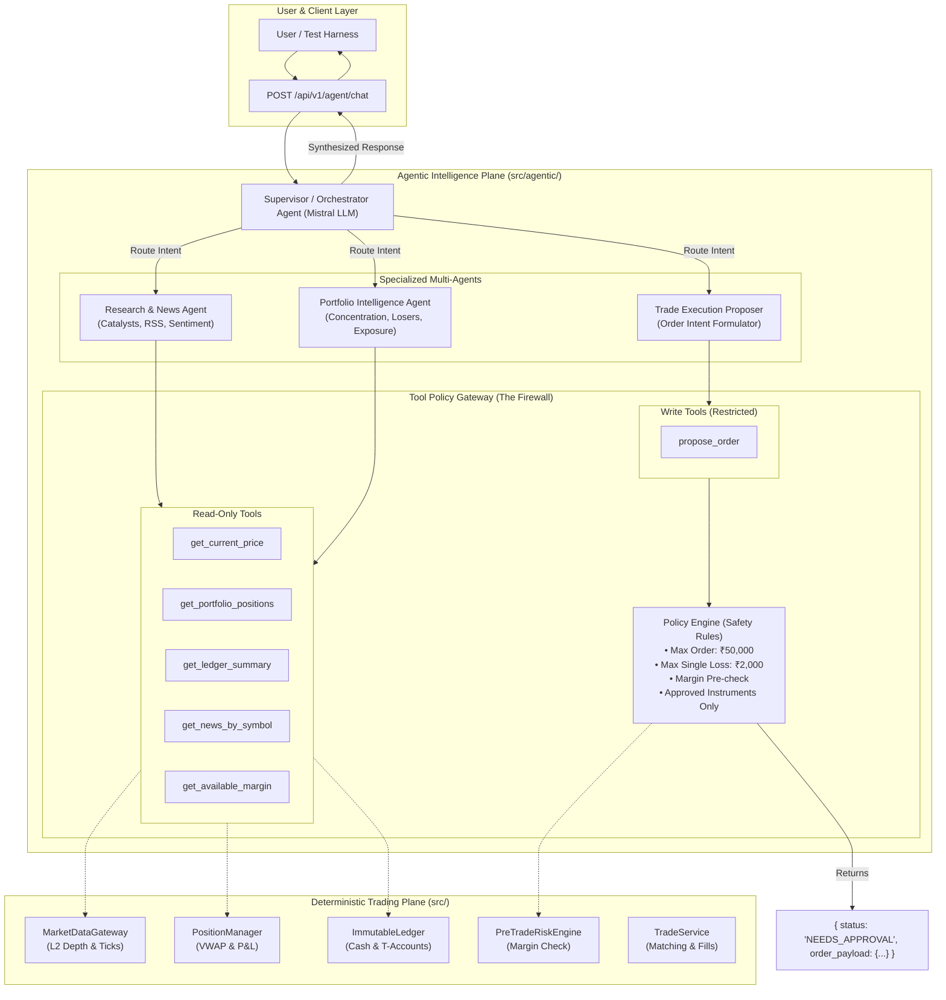

# Phase 5: Agentic Intelligence Plane & Tool Policy Gateway — Architectural Plan

## 1. Executive Summary & Vision

This document details the architectural plan for **Phase 5: Agentic Intelligence Plane & Tool Policy Gateway** of the **PS-05 Paper Trading Platform**.

In strict accordance with `docs/plan.txt` (Sections 1–4, 12–14, 34, 50) and `docs/ps.txt`, the AI layer runs as an **isolated, asynchronous intelligence plane**. It reads domain state from the deterministic trading plane via a secured **Tool Gateway** and proposes trade actions strictly governed by a **Policy Engine** and human approval. The deterministic matching core is completely insulated from LLM latency.

The design implements a **multi-agent system orchestrated using LangGraph's StateGraph (Supervisor Pattern)** powered by **Mistral AI (`langchain-mistralai`)**, packaged entirely inside our existing **Python modular monolith** (`src/agentic/`).

---

## 2. Architectural Blueprint



---

## 3. Technology Stack & Packages

1. **LLM Orchestration**:
   - `langgraph` ($\ge$ 0.2.0)
   - `langchain-core` ($\ge$ 0.3.0)
   - `langchain-mistralai` (`ChatMistralAI`, defaulting to `mistral-large-latest` or `mistral-small-latest`)
   - Pluggable Fallback / Mock LLM mode for isolated CI/CD unit testing without live API keys.
2. **Web Scraping & RSS Intelligence**:
   - `feedparser` / `httpx` (async)
   - Google News RSS: `https://news.google.com/rss/search?q={symbol}+stock+nse&hl=en-IN&gl=IN&ceid=IN:en`
   - Moneycontrol RSS: `https://www.moneycontrol.com/rss/latestnews.xml`
3. **Monolith Core Integration**:
   - `FastAPI`, `Pydantic v2`, `SQLAlchemy 2.0 Async`, `asyncpg`, `Decimal` for currency precision.

---

## 4. Multi-Agent Topology (LangGraph StateGraph Supervisor)

Rather than a single monolithic prompt, we implement **three dedicated specialist agents** coordinated by a **Supervisor Node**:

### A. Supervisor Node (`supervisor.py`)
- **Role**: Analyzes the user's incoming query and decides the routing path:
  - If query is about news, catalysts, fundamentals $\to$ delegate to `ResearchAgent`.
  - If query is about portfolio health, losses, margin, risk $\to$ delegate to `PortfolioAgent`.
  - If query requests an order (e.g., "Buy 1,000,000 shares of Reliance") $\to$ delegate to `TradeProposerAgent`.
  - When specialist work is complete $\to$ synthesizes the final coherent explanation and returns to the user.

### B. Research & News Specialist (`research_agent.py`)
- **Equipped Tools**: `get_current_price`, `get_news_by_symbol`, `get_symbol_catalysts`.
- **Function**: Queries live market prices and fetches/scrapes RSS feeds. Parses headlines, timestamps, source attribution, and provides structured catalyst summaries.

### C. Portfolio & Risk Specialist (`portfolio_agent.py`)
- **Equipped Tools**: `get_portfolio_positions`, `get_ledger_summary`, `get_available_margin`, `get_top_losers`.
- **Function**: Queries `PositionManager` and `ImmutableDoubleEntryLedger`. Calculates sector concentration, daily MTM drawdowns, margin utilization, and explains why a portfolio lost money.

### D. Trade Execution Proposer Specialist (`proposer_agent.py`)
- **Equipped Tools**: `propose_order`.
- **Function**: Translates natural language order intent into a formal order proposal. Calls the Policy Gateway, which evaluates safety rules. Returns rejection reasons or the structured `NEEDS_APPROVAL` ticket.

---

## 5. Tool Policy Gateway & Safety Engine

### A. Read Tools (`src/agentic/tools/read_tools.py`)
- `get_current_price(symbol: str) -> dict`: Returns LTP, bid/ask spread, OHLC from `MarketDataGateway`.
- `get_portfolio_positions(account_id: str) -> list`: Returns active positions, VWAP, unrealized P&L from `PositionManager`.
- `get_ledger_summary(account_id: str) -> dict`: Returns cash balance, reserved margin, and today's realized P&L from `ImmutableDoubleEntryLedger`.
- `get_news_by_symbol(symbol: str) -> list`: Returns sanitized RSS news articles with titles, dates, links, and summaries.

### B. Write Tools & Policy Engine (`src/agentic/policy/engine.py` & `src/agentic/tools/write_tools.py`)
The agent has **zero direct access** to execute orders. It only calls `propose_order`:

```python
class OrderProposal(BaseModel):
    account_id: str
    symbol: str
    side: Side  # BUY / SELL
    order_type: OrderType  # LIMIT / MARKET / SL
    quantity: int
    price: Optional[Decimal]
    product_type: ProductType  # CNC / MIS
```

#### Hard Safety Limits Enforced:
1. **Max Order Value Threshold**: Value ($\text{Quantity} \times \text{Price}$) cannot exceed **₹50,000**.
2. **Account Margin Check**: `PreTradeRiskEngine.calculate_required_margin(order)` must not exceed current `available_cash`.
3. **Max Single Loss Limit**: If stop-loss is attached, potential loss cannot exceed **₹2,000**.
4. **Allowed Instruments**: Symbol must be in active NSE equities universe.

#### Execution Output:
- **If Rejected**:
  ```json
  {
    "status": "REJECTED",
    "reason": "Cannot execute: Order exceeds maximum allowed account margin. Order rejected."
  }
  ```
- **If Allowed**:
  ```json
  {
    "status": "NEEDS_APPROVAL",
    "order_payload": {
      "proposal_id": "prop_89231",
      "account_id": "ACC_001",
      "symbol": "RELIANCE",
      "side": "BUY",
      "quantity": 10,
      "price": 2500.00,
      "estimated_margin": 5000.00,
      "status": "NEEDS_APPROVAL"
    }
  }
  ```

---

## 6. Monolithic Directory Structure for Phase 5

```
src/
└── agentic/
    ├── __init__.py
    ├── config.py                 # Mistral API settings & model params
    ├── state.py                  # LangGraph AgentState TypedDict
    ├── llm.py                    # Mistral LLM client & Mock fallback provider
    ├── graph.py                  # LangGraph StateGraph assembly & compiler
    ├── supervisor.py             # Supervisor orchestrator router node
    ├── agents/
    │   ├── __init__.py
    │   ├── research_agent.py     # Research & RSS News specialist
    │   ├── portfolio_agent.py    # Portfolio, P&L, & Concentration specialist
    │   └── proposer_agent.py     # Order formulation specialist
    ├── policy/
    │   ├── __init__.py
    │   ├── engine.py             # Hard limit rules (₹50k, ₹2k, Margin check)
    │   └── models.py             # Policy schemas (Proposal, Approval, Rejection)
    └── tools/
        ├── __init__.py
        ├── read_tools.py         # Read-only tools bound to domain core
        ├── write_tools.py        # propose_order bound to Policy Engine
        └── scraper.py            # Async RSS feed parser (Google News / Moneycontrol)
```

And in the API layer:
```
src/api/routers/agent.py          # POST /api/v1/agent/chat endpoint
```

---

## 7. Verification Suite & Exit Criteria

1. **Unit Tests**:
   - `test_policy_engine.py`:
     - Order value > ₹50,000 rejected.
     - Margin exceeding account balance rejected.
     - Valid orders return `{ status: "NEEDS_APPROVAL", order_payload: {...} }`.
   - `test_read_tools.py`:
     - `get_current_price`, `get_portfolio_positions`, `get_ledger_summary` return accurate live/stored values with zero latency side-effects.
   - `test_rss_scraper.py`:
     - Scrapes and parses RSS items with fallback mock tests for offline execution.
   - `test_multi_agent_graph.py`:
     - Verifies supervisor routing to Research, Portfolio, and Proposer nodes.
2. **Phase 5 Exit Criteria Verification**:
   - Submit user chat query: `"Buy 1,000,000 shares of Reliance."`
   - Verify agent executes the policy check and answers:
     > `"Cannot execute: Order exceeds maximum allowed account margin. Order rejected."`
   - Submit user chat query: `"Why did my portfolio lose money today?"`
   - Verify agent routes to Portfolio Specialist, queries positions/ledger, and returns sector concentration and top daily losers.
